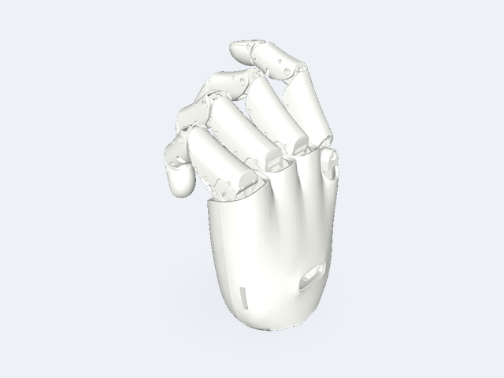
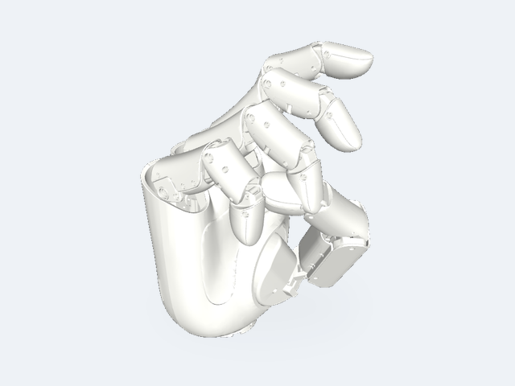
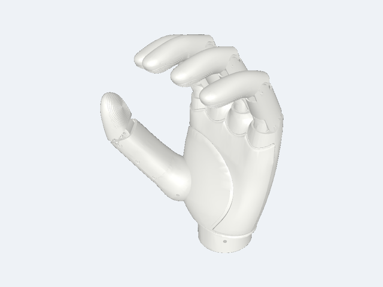
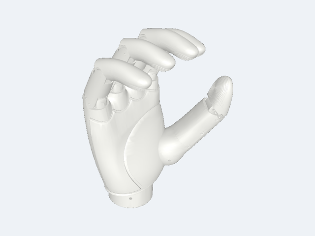

# GHand Assets

[中文](README.zh.md)

This repository contains public description assets for GHand. The package supports simulation, visualization, algorithm verification and robotics development.
The release provides URDF, MJCF and USD robot models, along with corresponding mesh geometric files.

## What Is Included

| System           | Description                                                          | Formats         |
|----|---|---|
| `ghand5_system`   | GHand 5 left and right dexterous hands                                 | URDF, MJCF, USD |
| `ghand_lite1_system`   | GHand Lite 1 left and right dexterous hands                                 | URDF, MJCF, USD |

## Visual Catalog

| Preview | Description files | Hand | Configuration | Side |
|---|---|---|---|---|
|  | URDF: ghand5_system/urdf/ghand5_left.urdf MJCF: ghand5_system/mjcf/ghand5_left.mjcf USD: ghand5_system/usd/ghand5_left/ghand5_left.usd | GHand 5 | Single hand | Left |
|  | URDF: ghand5_system/urdf/ghand5_right.urdf MJCF: ghand5_system/mjcf/ghand5_right.mjcf USD: ghand5_system/usd/ghand5_right/ghand5_right.usd | GHand 5 | Single hand | Right |
|  | URDF: ghand_lite1_system/urdf/glite1_left.urdf MJCF: ghand_lite1_system/mjcf/glite1_left.mjcf USD: ghand_lite1_system/usd/glite1_left/glite1_left.usd | GHand Lite 1 | Single hand | Left |
|  | URDF: ghand_lite1_system/urdf/glite1_right.urdf MJCF: ghand_lite1_system/mjcf/glite1_right.mjcf USD: ghand_lite1_system/usd/glite1_right/glite1_right.usd | GHand Lite 1 | Single hand | Right |

## Using the Models
URDF files can be loaded by common robotics tools such as ROS, RViz, Pinocchio, and other URDF-compatible parsers.

Note: GHand 5 URDF and USD use linear approximations for the five passive joints, so their coupling has approximation error relative to the SDK kinematic model.
