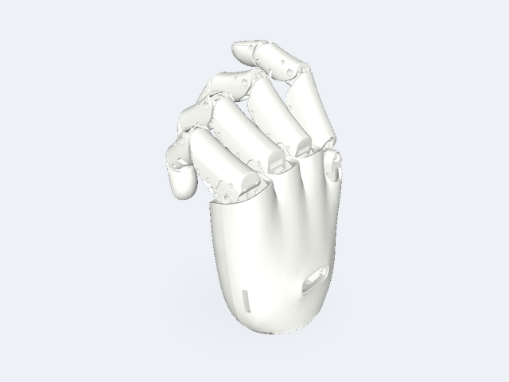
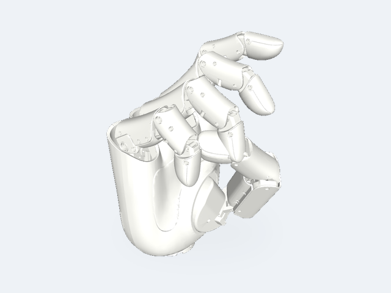
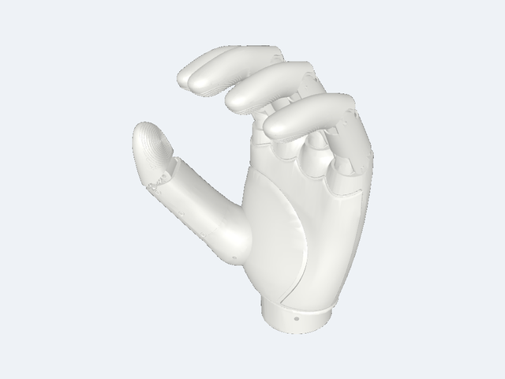
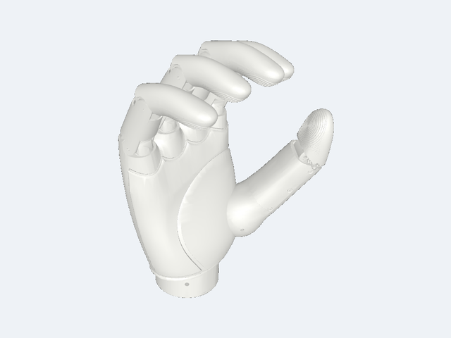

# GHand Assets

[English](README.md)

本仓库包含 GHand 灵巧手的公开描述资源包。该资源包支持仿真、可视化、算法验证与机器人开发。
版本发布提供 URDF、MJCF 和 USD 机器人模型，以及对应的几何网格文件。

## 包含内容

| 系统 | 说明 | 格式 |
|---|---|---|
| `ghand5_system` | GHand 5 左/右灵巧手 | URDF、MJCF、USD |
| `ghand_lite1_system` | GHand Lite 1 左/右灵巧手 | URDF、MJCF、USD |

## 视觉目录

| 预览 | 描述文件 | 手部型号 | 配置 | 左右 |
|---|---|---|---|---|
|  | URDF: ghand5_system/urdf/ghand5_left.urdf MJCF: ghand5_system/mjcf/ghand5_left.mjcf USD: ghand5_system/usd/ghand5_left/ghand5_left.usd | GHand 5 | 单手 | 左 |
|  | URDF: ghand5_system/urdf/ghand5_right.urdf MJCF: ghand5_system/mjcf/ghand5_right.mjcf USD: ghand5_system/usd/ghand5_right/ghand5_right.usd | GHand 5 | 单手 | 右 |
|  | URDF: ghand_lite1_system/urdf/glite1_left.urdf MJCF: ghand_lite1_system/mjcf/glite1_left.mjcf USD: ghand_lite1_system/usd/glite1_left/glite1_left.usd | GHand Lite 1 | 单手 | 左 |
|  | URDF: ghand_lite1_system/urdf/glite1_right.urdf MJCF: ghand_lite1_system/mjcf/glite1_right.mjcf USD: ghand_lite1_system/usd/glite1_right/glite1_right.usd | GHand Lite 1 | 单手 | 右 |

## 使用模型

URDF 文件可由 ROS、RViz、Pinocchio 及其他兼容 URDF 的解析器加载。

注：GHand 5 的 URDF 和 USD 对五个从动关节采用线性近似，与 SDK 运动学模型相比存在误差。
